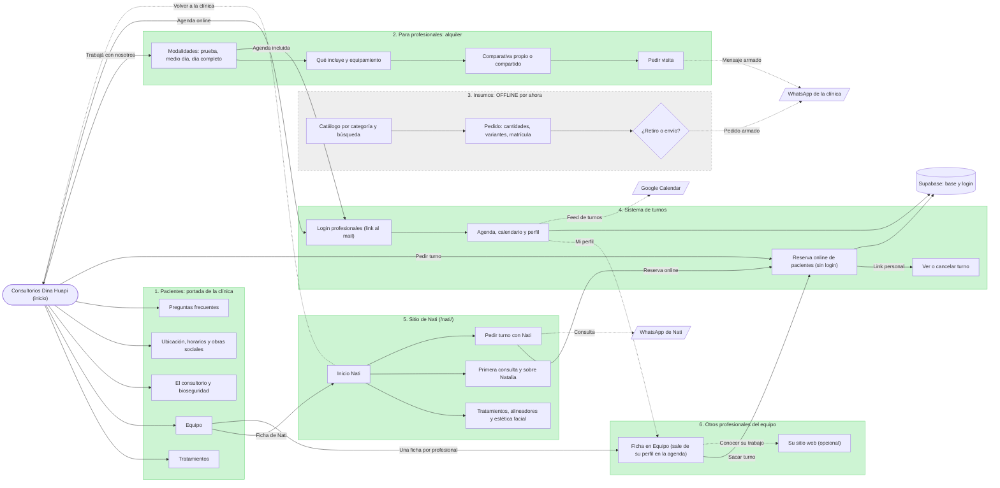

# Mapa del sitio

Copia versionada del diagrama editable en FigJam: https://www.figma.com/board/aByZhh0xM4F626XPdWcg7Y (la versión más nueva es la de más a la derecha).
GitHub muestra este diagrama renderizado. Si cambia la estructura, actualizar los dos.

Portada: la clínica (pacientes). Desde ahí salen el alquiler para profesionales, los turnos y el sitio de Nati.
Verde: va online en el lanzamiento. Gris punteado: insumos, offline por ahora (el código queda en `insumos/`, sin links).

| Ruta | Página |
|---|---|
| `/` | Portada de la clínica para pacientes |
| `/profesionales/` | Alquiler de consultorio |
| `/insumos/` | Catálogo y pedido de insumos (offline por ahora) |
| `/turnos/` | Reserva de pacientes, panel de profesionales y admin |
| `/nati/` | Sitio de Nati |

