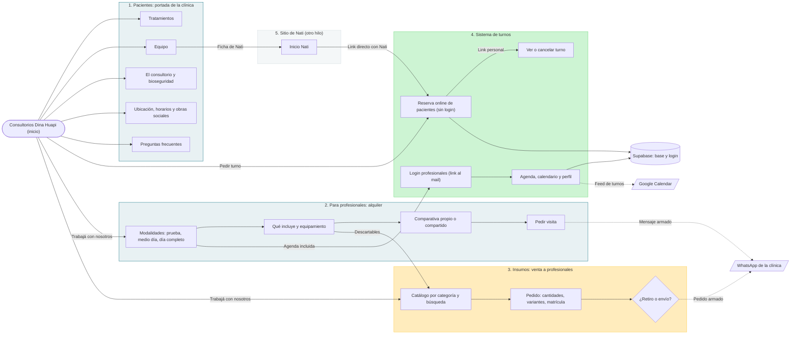

# Mapa del sitio

Copia versionada del diagrama editable en FigJam: https://www.figma.com/board/aByZhh0xM4F626XPdWcg7Y (el v2 está al lado del original).
GitHub muestra este diagrama renderizado. Si cambia la estructura, actualizar los dos.

Portada: la clínica (pacientes). Desde ahí salen el alquiler para profesionales, la tienda de insumos y los turnos.
Amarillo: insumos, nuevo. Verde: turnos, ya existía. Gris: sitio de Nati, se arma en otro hilo.

| Ruta | Página |
|---|---|
| `/` | Portada de la clínica para pacientes |
| `/profesionales/` | Alquiler de consultorio |
| `/insumos/` | Catálogo y pedido de insumos (por WhatsApp) |
| `/turnos/` | Reserva de pacientes, panel de profesionales y admin |
| `/nati/` | Sitio de Nati (ruta reservada, otro hilo) |

