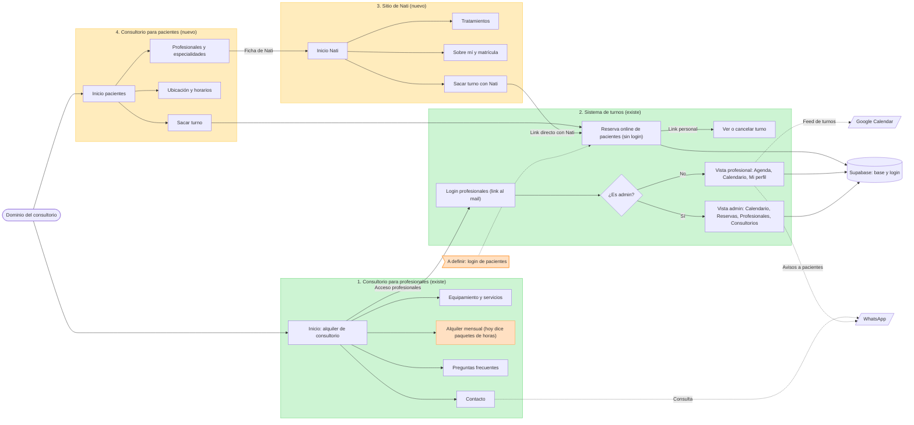

# Mapa del sitio

Copia versionada del diagrama editable en FigJam: https://www.figma.com/board/aByZhh0xM4F626XPdWcg7Y
GitHub muestra este diagrama renderizado. Si cambia la estructura, actualizar los dos.

Verde: existe. Amarillo: nuevo, a definir. Naranja: decisión o corrección pendiente.

## Estado por sección

| # | Sección | Público | Estado | Dónde está |
|---|---|---|---|---|
| 1 | Consultorio para profesionales | Profesionales que alquilan | Existe (borrador con datos a completar) | `index.html` |
| 2 | Sistema de turnos | Pacientes y profesionales | Existe, falta configurar Supabase | `turnos/`, `supabase/` |
| 3 | Sitio de Nati | Pacientes de Nati | Nuevo | — |
| 4 | Consultorio para pacientes | Pacientes en general | Nuevo | — |

## Decisiones pendientes antes de producción

1. **Dominio y URLs.** ¿Un dominio con secciones (`/profesionales`, `/pacientes`, `/nati`) o dominios separados? Nati con dominio propio es más fuerte como marca personal, pero cuesta más mantenerlo.
2. **Puerta de entrada.** Hoy la home (`index.html`) les habla a profesionales. Con un sitio para pacientes, la raíz del dominio tiene que decidir a quién le habla primero, o ser una portada con dos caminos.
3. **Login de pacientes.** Hoy los pacientes reservan sin cuenta (menos fricción). Con login ganan historial y gestión de sus turnos, a cambio de fricción y más datos personales para resguardar.
4. **Modelo comercial en la sección 1.** El sitio dice "paquetes de horas"; el modelo real es de alquileres mensuales.
5. **Contenido del sitio de Nati.** Tratamientos, foto, matrícula, obras sociales, ubicación y reseñas. Las reseñas deberían ser reales y verificables.
6. **Datos personales.** Política de privacidad y registro de la base ante la AAIP (Ley 25.326) antes de abrir la reserva a pacientes.
